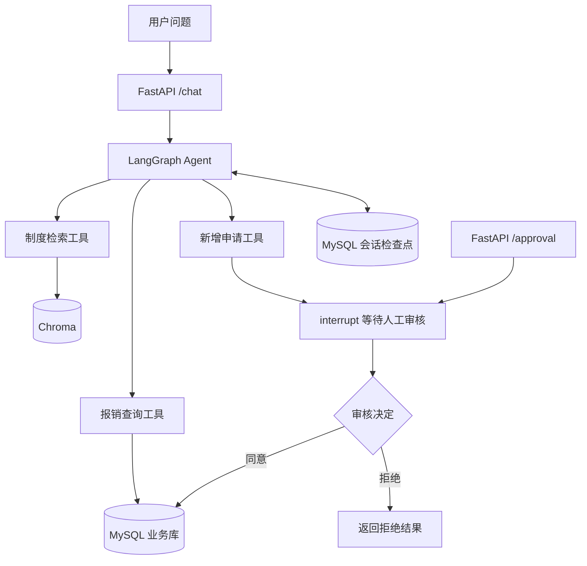

# 企业制度与报销 Agent 助手

基于 Python、FastAPI 和 LangGraph 的本地 AI 应用项目。通过自然语言查询公司制度和报销记录，并将新增申请串成“生成草稿 → 人工审核 → 同意后入库 → 按编号查询”的流程。

制度问答使用 RAG（检索增强生成），会话状态使用 MySQL 检查点持久化。知识库和种子数据均为教学演示内容。

## 已实现功能

- **制度问答**：切分制度文本，使用 bge-m3 生成向量，通过 Chroma 检索参考资料。
- **报销查询**：按申请编号查询 MySQL 中的金额和处理状态。
- **人工审核**：使用 interrupt（中断）暂停申请，通过审核接口传入同意或拒绝决定，再恢复图执行。
- **审核后写入**：同意后提交业务记录，拒绝后不创建业务记录；提交成功不代表财务已付款。
- **会话恢复**：相同 session_id（会话编号）可以继续历史对话，支持服务重启后恢复。
- **上下文摘要**：累计到阈值后，将新增旧消息合并进摘要，并保留最近对话参与模型输入。
- **运行追踪与批量实验**：支持 LangSmith 追踪，以及通过 HTTP 调用接口的串行评测脚本。

同一会话、同一次工具调用使用稳定的报销编号，配合数据库主键避免重新执行时生成重复记录。另一次工具调用属于另一笔申请。

## 技术与数据分工

| 组件 | 当前用途 |
| --- | --- |
| FastAPI | 提供问答和人工审核接口，使用 Swagger 文档进行交互 |
| LangGraph | 编排模型、工具调用、中断恢复和状态更新 |
| Ollama / qwen3:4b | 本地对话、工具选择和摘要生成 |
| Ollama / bge-m3 | 制度文本与问题的向量化 |
| Chroma | 保存和检索制度文本片段 |
| MySQL 业务库 | 保存报销申请、金额、用途和状态 |
| MySQL 会话库 | 保存 LangGraph 检查点，恢复同一会话的状态 |
| LangSmith | 可选的运行追踪与实验结果查看 |

会话持久化和摘要服务于同一会话的连续交互；当前没有跨会话的用户偏好记忆库。

## 业务流程



## 项目结构

```text
enterprise_assistant/
├── main.py                 # FastAPI 接口及检查点连接生命周期
├── agent_graph.py          # 图构建、模型调用与上下文摘要
├── expense_tools.py        # 报销查询与人工审核工具
├── expense_repository.py   # MySQL 业务查询、写入和事务处理
├── knowledge_tools.py      # 提供给模型的制度检索工具
├── search_knowledge.py     # Chroma 检索与问题向量化
├── build_index.py          # 首次构建知识库索引
├── init_memory.py          # 初始化会话检查点表
├── inspect_chunks.py       # 查看文本切片的辅助脚本
├── evaluate_rag.py         # 通过 HTTP 执行 LangSmith 问答实验
├── knowledge.txt           # 教学演示制度知识库
├── sql/
│   ├── schema.sql          # 创建业务库和报销表
│   ├── seed.sql            # 插入演示报销记录
│   └── docker_memory.sql   # Docker 会话库与账号权限
├── examples/               # 数据库和工具调用的学习脚本
├── Dockerfile              # FastAPI 镜像构建及启动方式
├── compose.yaml            # 容器服务、网络和数据卷
├── .env.docker.example     # Docker 配置模板
├── requirements.txt        # 当前环境的直接依赖版本
├── .env.example            # 可提交的配置模板
└── .gitignore
```

本地生成的 .venv、chroma_db、缓存目录和实际 .env 配置不随源码提交。examples 保留学习过程，不作为自动化测试套件或正式启动入口。

## Docker Compose 启动

在 Windows 上启动 Docker Desktop 和 Ollama，用 `ollama list` 确认已下载 `qwen3:4b` 和 `bge-m3`。容器通过 `host.docker.internal:11434` 访问 Windows 上的 Ollama。

首次配置时，在项目根目录创建 Docker 专用配置，然后填写两个 MySQL 密码。

```powershell
Copy-Item -LiteralPath .env.docker.example -Destination .env.docker
```

使用 Compose 构建并启动服务。

```powershell
docker compose --env-file .env.docker up --build -d
docker compose --env-file .env.docker logs -f api
```

首次启动时，MySQL 初始化演示业务库和会话库，接口容器在数据库就绪后构建知识索引。日志出现 `Application startup complete` 后，打开 [Swagger 接口文档](http://127.0.0.1:8888/docs)，按下文的接口演示操作。如果端口已被占用，可在 `.env.docker` 中修改 `API_PORT`，并用对应端口访问文档。接口绑定在本机回环地址，MySQL 在 Compose 网络内通过服务名 `mysql` 访问。

MySQL 记录和检查点保存在 `mysql_data`，Chroma 索引保存在 `chroma_data`。使用以下命令停止服务，数据卷会保留。再次执行启动命令可继续使用这些数据。

```powershell
docker compose --env-file .env.docker down
```

如需在 Docker 方式下开启 LangSmith 追踪，可将下文的 `LANGSMITH_*` 配置填入 `.env.docker`。

## 本地运行

以下步骤面向 Windows PowerShell，所有命令在项目根目录执行。开发环境使用 Python 3.12.10、MySQL 8.0 和 Ollama。

### 1. 安装 Python 依赖

新环境先创建虚拟环境，再安装依赖。已有可用解释器时，可以使用现有虚拟环境。

```powershell
py -3.12 -m venv .venv
.\.venv\Scripts\python.exe -m pip install -r requirements.txt
```

requirements.txt 锁定当前开发环境的直接依赖，没有包含 MySQL 服务、Ollama 软件或模型文件。

### 2. 填写配置

首次配置且根目录尚无 .env 时，将模板复制为 .env。已有 .env 时保留现有配置，核对所需字段即可。

```powershell
Copy-Item -LiteralPath .env.example -Destination .env
```

填写 MySQL 用户、密码和库名。两个数据库使用同一组连接配置，承担不同职责：

- MYSQL_DATABASE：业务库，当前建表脚本使用 enterprise_assistant。
- MYSQL_MEMORY_DATABASE：会话检查点库，下文使用 enterprise_assistant_memory 作为示例名称。

默认 LANGSMITH_TRACING=false，核心问答和审核流程可以在不启用追踪的情况下运行。

### 3. 初始化 MySQL

先启动 MySQL。在 Navicat 或 MySQL 客户端按顺序执行：

1. [sql/schema.sql](sql/schema.sql)：创建业务库和报销表。
2. [sql/seed.sql](sql/seed.sql)：插入演示数据，供下文的编号查询使用。

再执行以下 SQL 创建会话库，库名应与 .env 中的 MYSQL_MEMORY_DATABASE 一致：

```sql
CREATE DATABASE IF NOT EXISTS enterprise_assistant_memory
    DEFAULT CHARACTER SET utf8mb4;
```

可以提前检查连接并初始化会话表：

```powershell
.\.venv\Scripts\python.exe init_memory.py
```

主服务启动时也会调用检查点保存器的 setup（初始化），创建所需表并执行其迁移。该方法不负责创建数据库本身。数据库账号需要能访问两个库，并完成相关建表、读写操作。

seed.sql 对已存在的申请编号保留原记录，因此重复执行不会重置已修改的演示状态。

### 4. 准备 Ollama 模型

启动 Ollama 应用，使服务运行在 http://127.0.0.1:11434。尚未启动服务时，也可以在独立终端运行：

```powershell
ollama serve
```

在另一个终端下载模型，已经下载的可以跳过：

```powershell
ollama pull qwen3:4b
ollama pull bge-m3
```

当前主模型配置为 qwen3:4b，num_ctx（上下文窗口）为 10240。实际生成速度取决于硬件、上下文长度和模型的思考开销。

### 5. 首次构建制度索引

```powershell
.\.venv\Scripts\python.exe build_index.py
```

脚本读取 knowledge.txt，在本地 chroma_db 目录保存 company_knowledge 集合。

当前脚本发现集合已有数据时会输出“已有资料”并退出；它用于首次初始化，修改知识文件后不会自动覆盖旧索引。增量更新和索引重建流程尚未封装。

### 6. 启动接口

```powershell
.\.venv\Scripts\python.exe main.py
```

打开 [Swagger 接口文档](http://127.0.0.1:8888/docs)。保持 MySQL 和 Ollama 服务运行。

## 接口演示

首次测试使用未使用过的 session_id；多轮追问保留相同编号。重新测试整套流程时更换编号，避免混用先前会话。

### 制度问答：POST /chat

```json
{
  "question": "去上海出差，住宿费每人每晚最高报销多少？",
  "session_id": "demo-policy-001"
}
```

演示知识库中的标准为每人每晚500元，其他票据要求和例外以检索资料为准。

### 查询已有报销：POST /chat

先执行 seed.sql，再发送：

```json
{
  "question": "查询BX2026001的报销金额和当前状态。",
  "session_id": "demo-query-001"
}
```

该记录在初次插入的种子数据中为800元、已付款；如果本地修改过记录，查询应以实际数据库内容为准。

### 新增报销：POST /chat

```json
{
  "question": "申请人工号EMP001，报销800元，用途是上海出差两晚住宿费，请提交人工审核。",
  "session_id": "demo-submit-001"
}
```

预期暂停并返回 status 为 pending_approval 的响应。保存两个不同的编号：

| 返回位置 | 含义 |
| --- | --- |
| approval_requests[0].id | 中断产生的审核编号，传给审核接口 |
| approval_requests[0].data.draft.application_id | 程序生成的报销申请编号，用于业务查询 |

暂停时只有草稿和会话状态，尚未写入报销业务表。

### 人工决定：POST /approval

将 approval_id 替换为本次返回的审核编号，session_id 保持原值：

```json
{
  "session_id": "demo-submit-001",
  "approval_id": "替换为本次返回的审核编号",
  "approved": true
}
```

- approved 为 true：同意后写入业务表，初始状态为“已提交”，随后返回模型组织的结果说明。
- approved 为 false：拒绝，不创建业务记录。测试拒绝分支时，先用新会话发起另一笔待审核申请。
- 不能把报销申请编号当作 approval_id；错误会话、无待审任务或已经处理过的审核编号应返回 HTTP 409。

同意后，可通过 /chat 按报销申请编号查询，也可在数据库中回查：

```sql
SELECT application_id, applicant_id, amount, purpose, status
FROM enterprise_assistant.enterprise_assistant
WHERE application_id = '替换为草稿中的报销申请编号';
```

“已提交”表示申请已保存，不表示财务审核完成或已付款。

## LangSmith 追踪与实验（可选）

在 .env 中填写 LANGSMITH_API_KEY，将 LANGSMITH_TRACING 设为 true，并确认 endpoint（服务地址）、agent（应用标识）及 environment（环境）配置属于自己的工作空间。模板默认使用 enterprise-assistant 和 local。

追踪中可以查看模型输入输出、工具调用和耗时；启用后，相应运行内容会上传至所配置的 LangSmith 服务。

[evaluate_rag.py](evaluate_rag.py) 默认读取 LangSmith 中名为 enterprise-rag-basic-v1 的数据集。运行前，在自己的工作空间准备同名数据集，输入字段使用 input，参考输出字段使用 output，并保持 FastAPI 和 Ollama 运行。

```powershell
.\.venv\Scripts\python.exe evaluate_rag.py
```

脚本使用独立会话串行调用 /chat，记录输出及耗时，当前没有配置自动正确率评分器。它用于普通问答数据；人工审核中断需要按前面的双接口流程验收。

## 当前验收情况与范围

维护者已反馈通过以下本地手动验收：

- 制度查询、缺少参数时追问。
- 审核暂停后的服务重启恢复、同意后入库与拒绝后不入库。
- 重复审核及错误会话审核返回409，按业务编号回查。
- 普通对话重启恢复与不同会话的个人信息隔离。

6000 token 摘要阈值触发仍待单独专项验收。当前摘要触发时保留最近3轮对话；摘要限制的是送入模型的历史范围，不等于清空全部检查点历史。

当前版本使用同步调用、Swagger 演示交互和教学数据，尚未提供独立前端、用户登录与审批角色校验、撤回或删除申请等能力。session_id 用于会话恢复，不代表用户身份验证。
